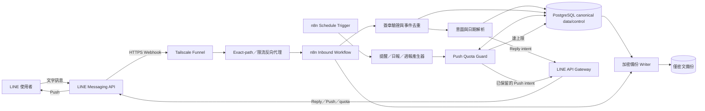
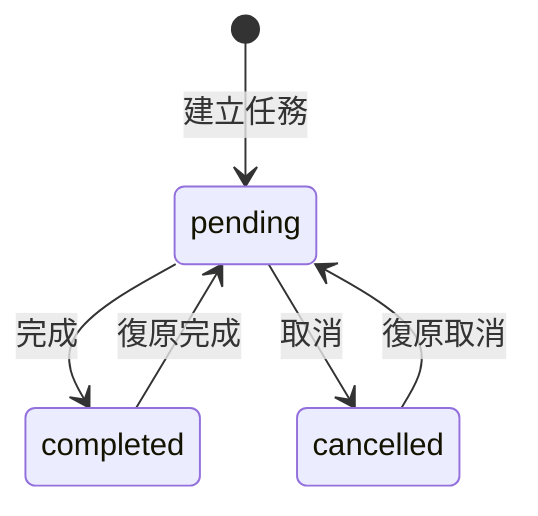

# LINE × n8n 個人任務助理系統規格書

| 文件欄位 | 內容 |
|---|---|
| 文件版本 | 1.1（安全強化版） |
| 文件狀態 | 實作基準版 |
| 建立日期 | 2026-10-24 |
| 系統代號 | LNTA（LINE n8n Task Assistant） |
| 目標版本 | MVP 1.0 |
| 主要語言 | 繁體中文 |
| 預設時區 | Asia/Taipei |
| 安全修訂日期 | 2026-10-24 |

---

## 1. 文件目的

本文件定義一套以 LINE 作為使用者介面、n8n 作為自動化引擎的個人任務紀錄與提醒系統。系統讓使用者能用自然語言新增、修改、完成、取消及查詢任務，並依任務時間發送提醒、每日摘要與每週報告。

第一版以以下原則為核心：

1. 單一使用者、LINE 一對一私聊。
2. 不使用已停止服務的 LINE Notify，改用 LINE Official Account Messaging API。
3. 採零訂閱費架構，自架 n8n Community Edition。
4. 不使用付費 AI API；中文日期解析以規則式解析器為主。
5. 每月主動 Push 訊息硬上限為 199 則，禁止超額發送。
6. 達 Push 上限後，任務仍照常記錄；使用者主動傳訊時仍可透過免費 Reply 訊息查詢。

---

## 2. 專案目標

### 2.1 主要目標

- 使用者可直接在 LINE 中用口語記錄任務。
- 系統能正確解析日期、時間、地點與任務內容。
- 任務到期前 24 小時及 1 小時提醒使用者。
- 任務到期後仍未完成時，通知一次已逾期。
- 每日整理當日任務，每週整理完成與未完成狀況。
- 所有主動通知受到每月 199 則 Push 硬上限保護。
- 在不購買 n8n Cloud、資料庫、AI API 或網域的前提下運作。

### 2.2 成功指標

| 指標 | 目標 |
|---|---|
| 明確格式任務建立成功率 | 100% |
| 常見中文相對日期解析成功率 | ≥ 95% |
| 重複 Webhook 導致重複任務 | 0 件 |
| 同一提醒重複發送 | 0 件 |
| 每月 Push 發送量 | ≤ 199 則 |
| 已完成／已取消任務仍收到提醒 | 0 件 |
| 日報、週報時間誤差 | ≤ 5 分鐘 |
| n8n 重啟後任務資料遺失 | 0 件 |

---

## 3. 系統範圍

### 3.1 MVP 內含功能

- LINE 使用者綁定。
- 自然語言新增任務。
- 任務日期與時間解析。
- 新增結果確認與絕對日期回顯。
- 修改任務內容或時間。
- 完成任務。
- 取消任務。
- 查詢今日、明日、本週、未完成及逾期任務。
- 到期前 24 小時提醒。
- 到期前 1 小時提醒。
- 到期後單次逾期通知。
- 每日摘要。
- 每週完成／未完成報告。
- LINE Webhook 簽章驗證。
- Webhook 事件去重。
- Push 月額度查詢、本地計數、199 則硬上限。
- Push 失敗重試及重複發送保護。
- 錯誤記錄與本機備份。

### 3.2 MVP 不包含

- 多使用者共用任務。
- LINE 群組任務。
- 任務附件、圖片或語音辨識。
- Google Calendar、Notion、Todoist 等外部同步。
- 跨裝置網頁管理後台。
- 複雜重複任務，例如每月最後一個工作日。
- 依 GPS 位置提醒。
- 付費生成式 AI 服務。
- 保證等級 SLA。

### 3.3 後續版本候選

- 多使用者及權限管理。
- LINE 群組內指定成員。
- 週期性任務與 RRULE。
- 本機 Ollama 輔助理解複雜句子。
- Google Calendar 雙向同步。
- LIFF 任務管理頁面。
- 任務標籤、專案、優先級與統計圖表。

---

## 4. 使用者與角色

### 4.1 一般使用者

第一版只有一位主要使用者，可執行所有任務操作並接收通知。

### 4.2 系統管理者

通常與一般使用者為同一人，負責：

- 維護 n8n 主機。
- 管理 LINE Channel Secret 與 Channel Access Token。
- 查看 n8n 執行記錄。
- 匯出或還原任務資料。
- 更新工作流程與規則。

---

## 5. 名詞定義

| 名詞 | 定義 |
|---|---|
| Reply | 回覆使用者剛觸發的 LINE Webhook，不列入方案訊息則數。 |
| Push | 系統主動傳送的 LINE 訊息，列入每月訊息額度。 |
| 任務 | 使用者要在指定時間前完成或參與的事項。 |
| 到期時間 | 任務預定發生或完成的日期時間。 |
| 全天任務 | 有日期但沒有確切時間的任務。 |
| 逾期 | 任務狀態仍為 pending，且 due_at 早於目前時間。 |
| 日報 | 每天固定時間整理當日與逾期任務。 |
| 週報 | 每週固定時間整理完成、未完成及逾期任務。 |
| 硬上限 | 系統禁止超越的 Push 計數，本系統設定為 199。 |
| 抑制 | 因額度或規則而不發送，但仍保留通知記錄。 |

---

## 6. 預設設定

| 設定 | 預設值 |
|---|---|
| 時區 | Asia/Taipei |
| 每日摘要時間 | 07:30 |
| 每週報告時間 | 星期日 20:00 |
| 第一階段提醒 | 到期前 24 小時 |
| 第二階段提醒 | 到期前 1 小時 |
| 逾期提醒 | 到期後首次掃描時通知一次 |
| 排程掃描頻率 | 每 5 分鐘 |
| Push 硬上限 | 每月 199 則 |
| 空日報 | 不發送 |
| 空週報 | 不發送 |
| 無明確時間的任務 | 詢問時間，或經使用者確認後建立全天任務 |
| 逾期狀態 | 動態計算，不改寫任務主狀態 |

---

## 7. 系統架構



### 7.1 免費部署元件

| 元件 | 建議方案 | 費用 |
|---|---|---|
| 對話介面 | LINE Official Account 輕用量方案 | 0 元，受免費訊息額度限制 |
| 自動化引擎 | n8n Community Edition，自架 Docker | 0 元訂閱費 |
| 應用程式資料 | 本機 PostgreSQL 容器，保存任務、提醒與安全控制狀態 | 0 元 |
| n8n 系統資料庫 | 預設 SQLite 與持久化 Volume | 0 元 |
| 公開 HTTPS | Tailscale Funnel | 個人免費方案 |
| 日期解析 | n8n Code node JavaScript 規則 | 0 元 |
| 進階 AI | MVP 不使用；選配本機 Ollama | 0 元 API 費 |
| 備份加密 | `age` 公鑰加密或等效 authenticated encryption | 0 元 |

### 7.2 運作前提

- 自架主機必須長時間開機並連接網路。
- 主機睡眠、關機或斷網期間不能接收 Webhook，也不能準時提醒。
- 所有 n8n 資料必須使用持久化 Volume。
- 公開入口只應暴露 LINE Webhook 路徑，不應直接公開 n8n 編輯介面。
- 唯一公開 callback 為 `POST /webhook/line-events`；n8n Webhook node 的 Path 設為 `line-events`，不得再使用 `/line/events` 或額外公開其他 production/test webhook。
- Tailscale Funnel 只能指向前置反向代理，不得直接指向 n8n `5678`。
- `users`、tasks、reminders、effect ledger、event claim 與 Push quota/reservation 皆以本機 PostgreSQL 為 canonical store；不得用 Data Tables 的「先查再寫」取代交易、唯一約束或 fencing。

---

## 8. 功能需求

### 8.1 使用者註冊與識別

#### FR-001 使用者建立

正式環境不得由外部訊息自動註冊新使用者。管理者必須先以非公開管理流程建立唯一允許的 `line_user_id`，確認 `is_allowed=true` 後才可啟用 Webhook workflow；後續 `follow` 或訊息事件只能更新該既有使用者的非安全性資料。

#### FR-002 使用者唯一性

相同 `line_user_id` 不得建立重複使用者。

#### FR-003 未授權使用者

正式環境必須設定且只能設定一個允許的 LINE User ID。設定缺失、空白、格式錯誤、重複或讀取失敗時，Webhook workflow 必須維持停用或 fail-closed；不得建立使用者、讀取任務或執行任何 CRUD。

非允許名單使用者只收到固定且不洩漏資料的說明訊息，不得建立、讀取或修改任務。新建 `users.is_allowed` 的安全預設值必須為 `false`，只能由管理者明確啟用。

#### FR-004 物件層授權

所有 task、reminder、conversation state、notification 及匯出／刪除操作，都必須從已驗簽事件的 `source.userId` 解析目前使用者，並在資料存取時同時限制 `id` 與 `user_id`。不得信任文字、postback data 或其他 client-controlled 欄位中的 `user_id`。

### 8.2 任務新增

#### FR-010 自然語言新增

系統應支援下列類型：

- 「明天中午去 327 教室找助教」
- 「下週二晚上十點要開會」
- 「10 月 30 日下午三點交企劃書」
- 「提醒我星期五打電話給老師」

#### FR-011 回顯解析結果

建立後應回覆：

- 任務編號。
- 任務標題。
- 絕對日期與時間。
- 地點（若有）。
- 已建立的提醒時間。
- 完成、修改、取消操作提示。

#### FR-012 資訊不足

日期或時間不足時，不得自行猜測高風險欄位，應要求補充。

#### FR-013 過去時間

若解析後時間早於目前時間，系統不得直接建立 pending 任務，應回覆：

- 指定時間已經過去。
- 可選擇記為已完成。
- 可選擇改期。
- 可選擇取消。

#### FR-014 建立後提醒排程

任務成功建立後應產生仍位於未來的提醒記錄：

- 到期前 24 小時。
- 到期前 1 小時。
- 到期時的逾期檢查。

### 8.3 任務修改

#### FR-020 修改時間

支援：

- 「把 #T042 改到星期三晚上九點」
- 「剛才那個改成下午一點」

修改 due_at 後，所有未發送提醒都應取消並重新建立。

#### FR-021 修改內容

支援修改標題、備註與地點。

#### FR-022 模糊參照

「剛才那個」只在最近上下文可唯一判定時直接操作；若有多個候選，應列出選項。

### 8.4 任務完成與取消

#### FR-030 完成任務

支援：

- 「完成 #T042」
- 「找助教完成了」
- 按下完成按鈕。

完成後應設定 `status=completed`、寫入 `completed_at`，並取消未發送提醒。

#### FR-031 逾期後完成

逾期任務仍可完成，週報應列入本週完成數，並可標示為延遲完成。

#### FR-032 取消任務

取消後設定 `status=cancelled`、寫入 `cancelled_at`，並取消未發送提醒。

#### FR-033 重複完成

已完成任務再次收到完成指令時，不得重複更新或產生新提醒，應回覆「此任務已完成」。

### 8.5 任務查詢

#### FR-040 支援查詢

- 「今天有什麼？」
- 「明天的任務」
- 「這週要做什麼？」
- 「未完成」
- 「逾期」
- 「查詢 #T042」

#### FR-041 排序

查詢結果依 due_at 升冪排序；逾期任務應置於最前方並清楚標示。

#### FR-042 無結果

無任務時應簡短回覆，不得產生錯誤或空白訊息。

### 8.6 提醒

#### FR-050 前 24 小時提醒

於 `due_at - 24h` 後第一次排程掃描發送。

#### FR-051 前 1 小時提醒

於 `due_at - 1h` 後第一次排程掃描發送。

#### FR-052 逾期通知

任務到期且仍為 pending 時，通知一次「任務已逾期」。後續不重複 Push，但仍顯示在日報與週報。

#### FR-053 短時間任務

- 建立時距到期少於 24 小時：不建立 24 小時提醒。
- 建立時距到期大於 1 小時：建立 1 小時提醒。
- 建立時距到期少於 1 小時：在建立確認中立即提示，不再另建 1 小時提醒。

#### FR-054 合併提醒

同一使用者在同一個 5 分鐘掃描區間內的多筆提醒應合併成一個 Push request。

### 8.7 每日摘要

#### FR-060 發送時間

每日 07:30 產生今日摘要。

#### FR-061 日報內容

- 今日任務，依時間排序。
- 目前逾期任務。
- 全天任務。
- 今日任務數量。

#### FR-062 空日報

沒有今日任務且沒有逾期任務時不 Push。

### 8.8 每週報告

#### FR-070 發送時間

每週日 20:00 產生本週報告。

#### FR-071 週報內容

- 本週完成數。
- 本週未完成數。
- 目前逾期數。
- 完成率。
- 未完成任務清單。
- 下週即將到期任務摘要。

#### FR-072 完成率公式

```text
完成率 = 本週已完成 /（本週已完成 + 本週應完成但未完成）× 100%
```

分母為 0 時顯示「本週無到期任務」，不顯示 0%。

### 8.9 Push 額度管理

#### FR-080 系統硬上限

每個計費月最多允許 199 則 Push 計數。

#### FR-081 使用量來源

系統同時維護：

- n8n 本地成功發送計數。
- LINE `/v2/bot/message/quota/consumption` 回報值。
- 已對帳的外部用量下限；每月只能單調增加，除非月初確認官方用量重置。

判斷值為：

```text
external_usage_floor = max(previous_external_usage_floor,
                           line_reported_usage
                           - local_committed_count
                           - uncertain_reservation_count,
                           0)

capacity_usage = local_committed_count
                 + external_usage_floor
                 + reserved_reservation_count
                 + uncertain_reservation_count
```

外部用量下限會把已由 LINE 看見、但不屬於本地 committed 或可能已接受 uncertain request 的差額永久計入當月容量，不得因下一次本地 commit 而下降。只有在同一個資料庫交易中成功保留一格、且保留後 `capacity_usage<=199` 的執行，才可要求 LINE API Gateway 發送 Push。讀取後再判斷、發送後才加一或依賴低併發，都不符合本要求。

#### FR-082 第 199 則訊息

當保留前 `capacity_usage=198` 且即將發送 Push 時：

- 先原子保留第 199 格，再正常發送原提醒。
- 在同一 Push request 內加入額度告警內容。
- 成功或由 LINE 409 確認先前已接受後，將該 reservation 原子轉為 committed，且本地 committed count 恰好加一。
- 在同一 commit transaction 設定 `warning_sent=true`；crash recovery 不得產生第二則告警或第二個 retry key。

#### FR-083 上限後行為

當 `capacity_usage>=199` 或原子 reservation 失敗：

- 不得呼叫 Push API。
- 將通知標記為 `suppressed_quota`。
- 任務、提醒及報表仍照常建立。
- 使用者主動查詢時，用 Reply API 告知已達上限。

#### FR-084 月初恢復

新月份開始後，系統應重新查詢 LINE 用量。只有在確認用量已重置後，才恢復 Push。

#### FR-085 不補發舊提醒

因額度被抑制且已過期的提醒不得於下個月補發，應改為 `expired`。仍未到期的任務則依原排程繼續提醒。

#### FR-086 外部訊息偵測

每次同步均須計算 `external_usage_floor`。若出現無法由 committed 或 uncertain reservation 解釋的新差額，立刻設 `push_suspended=true`，不得再保留或發送 Push；管理者必須撤銷其他發送權限、確認官方用量並記錄接受的當月外部 baseline，才可手動恢復。這項偵測是事故保護，不取代 BR-008 的專用帳號要求；若仍存在其他發送者，系統無法保證帳號總量不超過 199。

#### FR-087 用量查詢失敗

為確保不超過 199，當 LINE 用量 API 無法取得、且最近一次快取已超過 60 分鐘時，系統應採 fail-closed：暫停新的 Push，並記錄錯誤。使用者主動傳訊仍可收到 Reply。

#### FR-088 原子 reservation 與唯一發送者

- Reminder、Daily、Weekly 只能建立 notification intent，不得直接呼叫 LINE Push API。
- WF-07 是唯一可核准 Push 的 workflow；只有 WF-11 LINE API Gateway 實際持有 Channel Access Token 並呼叫 LINE endpoint。
- WF-11 接受 Push 要求前必須向 PostgreSQL 驗證 reservation、recipient、fingerprint 與狀態；接受 Reply 要求前必須驗證 event claim 與未使用的 reply-attempt marker。其他 workflow、手動節點、OA Manager 與外部工具不得持有 Token 或直接呼叫 LINE API。
- 每個 Push request 必須先建立一筆 reservation；`reservation_id` 等於第一次請求即固定的 `retry_key`，不得因重跑或 crash 產生新 key。
- `timeout` 或 5xx 後 reservation 維持 `uncertain`，只允許以相同 key 與完全相同 payload 重試，不得再占一格。
- 只有能確定 LINE 未接受的 4xx 才可 release；401/403 另須暫停 Push，429 必須先同步用量。
- Reminder 在原子 claim transaction 建立一個 batch occurrence UUID；Daily 使用 `daily:{user_id}:{local_date}`；Weekly 使用 `weekly:{user_id}:{iso_week}` 作唯一 occurrence key，防止排程重疊重複保留。

### 8.10 設定與輔助指令

#### FR-090 幫助

傳送「幫助」時，回覆可用範例與指令。

#### FR-091 額度查詢

傳送「額度」時，Reply 顯示：

- 本月本地 Push 計數。
- LINE 回報用量。
- 已對帳 external usage floor 與 active/uncertain reservations。
- 系統剩餘可用則數。
- 是否已暫停 Push。

#### FR-092 設定查詢

傳送「設定」時，Reply 顯示時區、日報時間、週報時間及提醒規則。

---

## 9. 對話與意圖規格

### 9.1 意圖類型

| intent | 說明 |
|---|---|
| `create_task` | 新增任務 |
| `update_task` | 修改任務 |
| `complete_task` | 完成任務 |
| `cancel_task` | 取消任務 |
| `list_tasks` | 列出任務 |
| `get_task` | 查詢單一任務 |
| `get_quota` | 查詢額度 |
| `get_settings` | 查詢設定 |
| `help` | 顯示說明 |
| `confirm` | 確認草稿操作 |
| `reject` | 拒絕草稿操作 |
| `unknown` | 無法判定 |

### 9.2 解析輸出格式

```json
{
  "intent": "create_task",
  "task_ref": null,
  "title": "去 327 教室找助教",
  "notes": null,
  "location": "327教室",
  "due_at": "2026-10-25T12:00:00+08:00",
  "is_all_day": false,
  "ambiguities": [],
  "requires_confirmation": false
}
```

### 9.3 中文日期規則

解析器必須以訊息收到時間及 Asia/Taipei 為基準。

支援：

- 今天、明天、後天。
- 星期一至星期日、週一至週日、禮拜一至禮拜日。
- 這週、下週。
- `YYYY/MM/DD`、`YYYY-MM-DD`、`M/D`、`M月D日`。
- 上午、早上、中午、下午、晚上、午夜。
- `X點`、`X點半`、`X:XX`、`X時X分`。

固定規則：

- 中午 12 點 = 12:00。
- 午夜 12 點 = 00:00。
- 下午 1～11 點加 12 小時。
- 晚上 1～11 點加 12 小時。
- 「下午」或「晚上」後沒有數字時，視為不明確。
- 只有星期幾而未指定「這週／下週」時，選擇下一個尚未過去的該星期，並在回覆顯示完整日期。
- 「月底」「下個月左右」「晚一點」等模糊字詞必須要求補充。

### 9.4 任務參照規則

解析優先順序：

1. 明確任務 ID。
2. 使用者訊息內可唯一匹配的任務標題。
3. 最近一次建立或操作的任務。
4. 若仍有多筆候選，要求使用者選擇。

### 9.5 建立回覆範例

```text
✅ 已建立任務 #T042

事項：去 327 教室找助教
時間：2026/10/25 12:00
地點：327 教室
提醒：10/24 12:00、10/25 11:00

可傳送「完成 #T042」、「修改 #T042」或「取消 #T042」。
```

### 9.6 額度告警範例

```text
⚠️ 本月主動提醒額度已達 199/199 則

為確保完全免費，本月剩餘提醒、日報與週報不再主動推送，
但任務仍會正常記錄。

你可以傳送「今天」、「待辦」、「逾期」或「週報」，
系統會使用 Reply 訊息回覆。下個月將自動恢復主動提醒。
```

---

## 10. 任務狀態模型



逾期不是永久狀態，定義為：

```text
is_overdue = status == "pending" AND due_at < now
```

如此可避免任務完成後仍停留在 overdue 狀態。

---

## 11. 資料模型

下列應用表皆以本機 PostgreSQL 為 canonical store，schema migration 必須建立文件所述的 PRIMARY KEY、FOREIGN KEY、UNIQUE、CHECK 與必要索引；n8n Data Tables 不保存 canonical 任務或安全控制狀態。

### 11.1 `users`

| 欄位 | 型別 | 必填 | 說明 |
|---|---|---|---|
| `id` | string/UUID | 是 | 內部使用者 ID，PRIMARY KEY |
| `line_user_id` | string | 是 | LINE User ID，儲存層 UNIQUE |
| `display_name` | string | 否 | LINE 顯示名稱 |
| `timezone` | string | 是 | 預設 Asia/Taipei |
| `daily_digest_time` | string | 是 | 預設 07:30 |
| `weekly_digest_day` | integer | 是 | 0=星期日 |
| `weekly_digest_time` | string | 是 | 預設 20:00 |
| `push_enabled` | boolean | 是 | 是否允許主動推播 |
| `is_allowed` | boolean | 是 | 是否為允許使用者，schema 預設 `false` |
| `created_at` | datetime | 是 | 建立時間 |
| `updated_at` | datetime | 是 | 更新時間 |

本表屬安全控制狀態並存於 PostgreSQL；Webhook 不得用 Data Tables 的可變使用者資料取代 allowlist 判斷。

### 11.2 `tasks`

| 欄位 | 型別 | 必填 | 說明 |
|---|---|---|---|
| `id` | string | 是 | 顯示 ID，例如 T042，PRIMARY KEY |
| `user_id` | string | 是 | 對應 users.id |
| `title` | string | 是 | 任務標題 |
| `notes` | text | 否 | 備註 |
| `location` | string | 否 | 地點 |
| `due_at` | datetime | 否 | ISO 8601，含時區或統一存 UTC |
| `is_all_day` | boolean | 是 | 是否全天任務 |
| `status` | enum | 是 | pending/completed/cancelled |
| `source_text` | text | 是 | 原始使用者輸入 |
| `completed_at` | datetime | 否 | 完成時間 |
| `cancelled_at` | datetime | 否 | 取消時間 |
| `created_at` | datetime | 是 | 建立時間 |
| `updated_at` | datetime | 是 | 更新時間 |

### 11.3 `task_reminders`

| 欄位 | 型別 | 必填 | 說明 |
|---|---|---|---|
| `id` | UUID | 是 | 提醒 ID，PRIMARY KEY |
| `task_id` | string | 是 | 對應 tasks.id |
| `user_id` | string | 是 | 對應 users.id |
| `kind` | enum | 是 | day_before/hour_before/overdue/custom |
| `remind_at` | datetime | 是 | 預定時間 |
| `status` | enum | 是 | scheduled/processing/sent/failed/cancelled/suppressed_quota/expired |
| `notification_id` | UUID | 否 | 原子指派的 notification_intents.id；一筆 reminder 最多屬於一個 intent |
| `attempt_count` | integer | 是 | 嘗試次數 |
| `last_error` | text | 否 | 最後錯誤 |
| `sent_at` | datetime | 否 | 成功時間 |
| `created_at` | datetime | 是 | 建立時間 |
| `updated_at` | datetime | 是 | 更新時間 |

### 11.4 `processed_events`

| 欄位 | 型別 | 必填 | 說明 |
|---|---|---|---|
| `webhook_event_id` | string | 是 | LINE webhookEventId，儲存層 PRIMARY KEY／UNIQUE |
| `line_message_id` | string | 否 | LINE message ID |
| `event_type` | string | 是 | message/follow/postback 等 |
| `status` | enum | 是 | claimed/succeeded/ignored/failed_before_effect/failed_after_effect |
| `claim_token` | UUID | 是 | 本次執行 claim，只有持有者可更新 |
| `lease_generation` | bigint | 是 | fencing token；每次合法接管原子加一 |
| `claimed_at` | datetime | 是 | claim 建立時間 |
| `lease_expires_at` | datetime | 是 | crash recovery 判定時間 |
| `last_completed_step` | string | 否 | 非敏感 checkpoint |
| `reply_attempted_at` | datetime | 否 | 防止 redelivery 再次 Reply |
| `completed_at` | datetime | 否 | 最終完成時間 |
| `error_summary` | string | 否 | 不含 message、body、signature 或 token 的摘要 |

第一次處理必須使用 `INSERT ... ON CONFLICT DO NOTHING`；只有成功插入者可繼續。stale recovery 只能用單一條件更新 `UPDATE ... WHERE status='claimed' AND lease_expires_at<clock_timestamp() AND lease_generation=:observed RETURNING ...` 原子換發 `claim_token`、增加 generation 並延長 lease。每個短交易開始時必須先鎖定 claim row，使用資料庫 statement clock 驗證 `claim_token + lease_generation` 仍相符且 lease 尚未過期，再於同一 transaction 寫入業務資料、effect 與 checkpoint；驗證或更新筆數不是 1 時整筆 rollback。舊 worker 即使復活也無法再提交，且 external API call 不得包在持有該 row lock 的 transaction 內。

### 11.5 `event_effects`

| 欄位 | 型別 | 必填 | 說明 |
|---|---|---|---|
| `webhook_event_id` | string | 是 | 對應 processed_events.webhook_event_id |
| `operation` | string | 是 | create_task/update_task/create_reminders/reply_attempt 等穩定名稱 |
| `idempotency_key` | string | 是 | 儲存層 UNIQUE；由 event ID + operation 衍生 |
| `status` | enum | 是 | prepared/attempted/committed |
| `object_id` | string | 否 | 已建立或修改的 canonical object ID |
| `payload_json` | JSON | 否 | Reply 等外部 effect 的 canonical payload；不得含 token |
| `request_fingerprint` | string | 否 | canonical payload 的雜湊 |
| `reply_token_hash` | string | 否 | Reply token 的單向雜湊；不保存明文 token |
| `lease_generation` | bigint | 是 | 建立 effect 時的 fencing generation |
| `updated_at` | datetime | 是 | 更新時間 |

PRIMARY KEY 為 `(webhook_event_id, operation)`。資料庫 CRUD、reminder 變更、effect row 及 checkpoint 必須在同一 PostgreSQL transaction 提交；重跑遇到 `committed` 只能讀取既有結果。Reply 等外部副作用必須先把 effect 原子改為 `attempted` 再呼叫 WF-11，以 at-most-once 方式處理；若在呼叫邊界 crash，允許遺失該次 Reply，但不得重複資料變更或重用 reply token。

### 11.6 `conversation_state`

| 欄位 | 型別 | 必填 | 說明 |
|---|---|---|---|
| `user_id` | string | 是 | 使用者 ID，PRIMARY KEY |
| `last_task_id` | string | 否 | 最近操作任務 |
| `pending_action` | string | 否 | 等待確認的操作 |
| `draft_json` | JSON/text | 否 | 任務草稿 |
| `expires_at` | datetime | 否 | 草稿有效期限 |
| `updated_at` | datetime | 是 | 更新時間 |

### 11.7 `push_quota`

| 欄位 | 型別 | 必填 | 說明 |
|---|---|---|---|
| `billing_month` | string | 是 | YYYY-MM，儲存層 PRIMARY KEY／UNIQUE |
| `local_committed_count` | integer | 是 | 已由 LINE 接受且完成 commit 的 Push request 數 |
| `line_reported_usage` | integer | 是 | LINE 最近回報值 |
| `external_usage_floor` | integer | 是 | 已對帳外部用量下限；月內單調不減 |
| `reserved_count` | computed | 否 | transaction 內從 reservations 計算，不持久化 counter |
| `uncertain_count` | computed | 否 | transaction 內從 reservations 計算，不持久化 counter |
| `capacity_usage` | computed | 否 | local committed + external floor + reserved + uncertain |
| `hard_limit` | integer | 是 | 固定 199 |
| `warning_sent` | boolean | 是 | 是否已告警 |
| `push_suspended` | boolean | 是 | 是否暫停 Push |
| `last_line_check_at` | datetime | 否 | 最後查詢時間 |
| `updated_at` | datetime | 是 | 更新時間 |

### 11.8 `push_reservations`

| 欄位 | 型別 | 必填 | 說明 |
|---|---|---|---|
| `reservation_id` | UUID | 是 | 等於 immutable LINE retry key，PRIMARY KEY／UNIQUE |
| `billing_month` | string | 是 | YYYY-MM |
| `notification_id` | string | 是 | 穩定 occurrence ID，與 billing_month 複合唯一 |
| `request_fingerprint` | string | 是 | 固定 recipient、message objects 與 type 的雜湊 |
| `status` | enum | 是 | reserved/uncertain/committed/released/expired |
| `reserved_at` | datetime | 是 | 保留時間 |
| `committed_at` | datetime | 否 | LINE 已接受時間 |
| `updated_at` | datetime | 是 | 更新時間 |

`push_quota` 與 `push_reservations` 位於同一原子狀態儲存。保留容量、建立 reservation 與檢查 `capacity_usage<=199` 必須在同一資料庫交易完成。

### 11.9 `notification_intents`

| 欄位 | 型別 | 必填 | 說明 |
|---|---|---|---|
| `id` | UUID/string | 是 | notification ID，PRIMARY KEY |
| `user_id` | string | 是 | 收件者 |
| `type` | enum | 是 | reminder/daily/weekly |
| `occurrence_key` | string | 是 | reminder batch UUID、`daily:{user}:{date}` 或 `weekly:{user}:{week}`，UNIQUE |
| `retry_key` | UUID | 是 | 建立 intent 時一次產生，immutable 且 UNIQUE |
| `payload_json` | JSON | 是 | immutable canonical LINE message objects；第 199 則告警加入後即封存 |
| `request_fingerprint` | string | 是 | canonical recipient + message objects + type 的雜湊 |
| `status` | enum | 是 | ready/sending/sent/failed/suppressed_quota |
| `created_at` | datetime | 是 | 建立時間 |
| `updated_at` | datetime | 是 | 更新時間 |

Reminder Dispatcher 必須在一個 transaction 內以 `FOR UPDATE SKIP LOCKED` 選取仍未指派的 due reminders、建立一個 intent、將相同 `notification_id` 寫回所有成員後提交；crash 前會整筆 rollback，crash 後只能恢復同一 intent。Daily/Weekly 以 occurrence_key 的 UNIQUE 避免排程重疊。

### 11.10 `notification_log`

| 欄位 | 型別 | 必填 | 說明 |
|---|---|---|---|
| `id` | UUID | 是 | 通知記錄 ID |
| `notification_id` | UUID/string | 是 | 對應 notification_intents.id，儲存層 UNIQUE |
| `user_id` | string | 是 | 使用者 ID |
| `task_id` | string | 否 | 關聯任務 |
| `type` | enum | 是 | reminder/daily/weekly/quota_warning |
| `status` | enum | 是 | sent/failed/suppressed_quota |
| `retry_key` | UUID | 否 | immutable Push retry key；存在時儲存層 UNIQUE |
| `line_request_id` | string | 否 | LINE 回應 request ID |
| `message_summary` | text | 否 | 非敏感摘要 |
| `created_at` | datetime | 是 | 建立時間 |

---

## 12. n8n 工作流程規格

### WF-01：LINE Inbound

**觸發：** n8n Webhook node Path `line-events`；唯一外部 URL 為 `POST /webhook/line-events`

**Webhook 設定：**

- Production URL。
- Respond Immediately。
- HTTP 200。
- 啟用 Raw Body。
- 不在未驗簽前處理 JSON 內容。
- 請求必須先通過反向代理的 method、exact path、2 MiB body、rate、connection 及 timeout 限制；代理不得解壓、改寫或重新序列化 body。

**流程：**

1. 收取原始 body 與 `x-line-signature`。
2. 使用 Crypto node，以 Channel Secret 做 HMAC-SHA256、Base64 編碼。
3. 比對簽章；失敗則停止處理並記錄安全事件。
4. 處理 `events=[]` 的 LINE Webhook 驗證請求。
5. Split Out 每個 event。
6. 以 `webhookEventId` 對原子狀態儲存執行 insert-if-absent，建立 `claimed` 記錄；只有成功 claim 的 execution 可繼續。
7. 若已存在：`succeeded/ignored` 或有效 lease 直接略過；stale claim 只能由 recovery workflow 以第 11.4 節的單一 compare-and-swap 接管並取得新 fencing generation，再從 `last_completed_step` 恢復。未取得新 token/generation 者立即停止。
8. 驗證來源是否為唯一允許的 User ID；設定不存在或讀取失敗時 fail-closed。未授權事件標記 `ignored`。
9. Switch event 類型：message、postback、follow、其他。
10. 文字訊息進入 Intent Parser 子流程。
11. 執行任務 CRUD 或查詢；所有存取同時綁定目前 `user_id`。每個資料庫副作用與對應 `event_effects`、checkpoint 必須在同一 transaction 寫入，且以最新 fencing token 為提交條件。
12. 若該事件尚未嘗試 Reply，先以最新 fencing token 原子保存 canonical Reply payload、fingerprint、reply token hash，建立／更新 `reply_attempt` effect 與 `reply_attempted_at`；再把只存在記憶體的原 token 交給 WF-11。redelivery 不得再次 Reply，資料庫與日誌不得保存明文 token。
13. 以最新 fencing token 原子更新 processed_events 為 `succeeded` 或 `ignored` 並記錄 checkpoint；更新筆數不是 1 時視為已失去 lease，停止所有後續動作。

**失敗原則：**

- 未通過簽章驗證不得進行任何資料操作。
- 未驗簽事件不得建立 claim；驗簽失敗日誌只保留固定摘要，不得記 raw body、signature 或完整訊息。
- Reply token 應盡快使用且只能使用一次。
- 任務已成功寫入但 Reply 失敗時，不得重複建立任務。
- `Respond Immediately` 後發生的失敗由內部 recovery workflow 掃描 stale claim；不得只依賴 LINE redelivery。

### WF-02：Intent Parser

**觸發：** Execute Sub-workflow

**輸入：**

- user_id。
- text。
- message_received_at。
- timezone。
- conversation_state。

**處理順序：**

1. 正規化全形／半形字元與空白。
2. 比對固定指令：完成、取消、查詢、額度、設定、幫助。
3. 解析任務 ID。
4. 解析日期片語。
5. 解析時間片語。
6. 擷取地點與標題。
7. 驗證日期是否合理。
8. 產出標準 JSON。
9. 若不足或衝突，產出 requires_confirmation。

### WF-03：Task CRUD

**觸發：** Execute Sub-workflow

**功能：**

- Create task。
- Update task。
- Complete task。
- Cancel task。
- Restore task。
- Rebuild future reminders。

**一致性要求：**

- task、reminder、event_effect 與 checkpoint 均寫入 PostgreSQL；一個指令的資料變更必須在同一 transaction 全部成功或 rollback。
- 建立任務與建立提醒在同一 transaction 完成。
- 更新 due_at 時在同一 transaction 取消舊 scheduled reminders，再建立新提醒。
- 完成或取消時在同一 transaction 停止所有尚未形成 committed Push 的提醒；已形成 intent 者由 WF-07 發送前再次檢查任務狀態。
- 所有 Select/Update/Complete/Cancel/Restore 必須同時使用 `task_id` 與目前已驗證的 `user_id`；postback 只可攜帶 opaque task/action ID，仍需在 WF-03 重新驗證 ownership。
- Create、提醒建立／重建、conversation state 變更都必須接受 WF-01 提供的穩定 idempotency key，並由 `event_effects` UNIQUE 約束強制；重跑相同 event 只能回傳原 object_id，不得建立第二份資料。

### WF-04：Reminder Dispatcher

**觸發：** Schedule Trigger，每 5 分鐘。

**流程：**

1. 開啟 transaction，以 `FOR UPDATE SKIP LOCKED` 查詢 `status=scheduled AND notification_id IS NULL AND remind_at<=now`。
2. 過濾非 pending 任務，將已失效提醒改為 cancelled 或 expired。
3. 對同一 user/time window 的成員建立一筆 notification intent，產生一次 immutable retry key 與 canonical payload。
4. 在同一 transaction 將 intent ID 指派給全部成員並把狀態改為 processing；若 crash，整筆 rollback，其他 dispatcher 才能重新選取。
5. commit 後呼叫 WF-07 Push Quota Guard；重啟或重疊排程只能恢復同一 intent/retry key。
6. WF-04 不得自行呼叫 LINE API；只有 WF-07 可核准 Push，只有 WF-11 可送出 HTTP request。
7. WF-07 回傳 committed 後，在同一 transaction 將 intent 及其成員標記 sent。
8. 達額度則將 intent 及其成員標記 suppressed_quota。
9. 失敗則依 reservation 狀態重試，不能重建 intent。

### WF-05：Daily Digest

**觸發：** 每天 07:30。

**查詢範圍：**

- 當地時間今日 00:00 至 23:59。
- 所有尚未完成的逾期任務。

**流程：**

1. 查詢今日與逾期任務。
2. 若結果為空則結束。
3. 依時間排序並格式化。
4. 以 `daily:{user_id}:{local_date}` 原子 upsert notification intent；只有該唯一 intent 呼叫 WF-07。
5. 記錄通知結果。

### WF-06：Weekly Report

**觸發：** 每週日 20:00。

**期間：** 當週星期一 00:00 至星期日 23:59。

**流程：**

1. 查詢 completed_at 位於本週的任務。
2. 查詢本週到期但仍 pending 的任務。
3. 查詢目前逾期任務。
4. 查詢下週即將到期任務。
5. 計算完成率。
6. 若完全無資料則結束。
7. 以 `weekly:{user_id}:{iso_week}` 原子 upsert notification intent；只有該唯一 intent 呼叫 WF-07。
8. 記錄通知結果。

### WF-07：Push Quota Guard

**觸發：** Execute Sub-workflow

**輸入：**

- user_id。
- notification_id。
- notification_type。
- message objects。
- retry_key。

**流程：**

1. 從 PostgreSQL 讀取 notification intent，驗證 `notification_id`、recipient、message objects、notification_type、retry key 與 fingerprint 均已固定；不得信任呼叫者自行傳入的 payload，同一 notification 不得產生第二個 key 或不同 payload。
2. 查詢既有 reservation；若為 committed，直接回傳成功且不得再送；若為 reserved/uncertain，沿用原記錄並跳過新容量保留。
3. 透過 WF-11 呼叫 LINE quota consumption API，更新 line_reported_usage、uncertain count 與單調不減的 external_usage_floor；快取超過 60 分鐘且查詢失敗時 fail-closed。
4. 若產生無法解釋的新 external delta，原子設 `push_suspended=true` 並拒絕；只有完成 BR-008 權限盤點與人工對帳後才可恢復。
5. 僅對尚無 reservation 的 intent，在同一 transaction 鎖定本月 quota row，計算 `capacity_usage=local_committed_count+external_usage_floor+reserved_count+uncertain_count`，並以 `reservation_id=retry_key` 原子保留一格。
6. 若已 suspended、保留失敗或保留後超過 199：回傳 denied_quota，且不得要求 Gateway 呼叫 Push API。
7. 若此 reservation 是第 199 格：在送出前將額度告警加入同一 request，重新計算 fingerprint，並在同一 transaction 更新 intent 與 reservation；後續 payload 不可再變。
8. WF-07 將 reservation ID 交給 WF-11；WF-11 從資料庫重建並驗證 request，第一次請求即帶 `X-Line-Retry-Key`。除 WF-11 外不得有 LINE Push HTTP call site。
9. HTTP 2xx：將 reservation 原子轉為 committed，`local_committed_count` 恰好加一並記錄 sent。
10. HTTP 409：若 reservation 尚未 committed，轉為 committed 並恰好計數一次；已 committed 則不重複計數。
11. 可確定未被接受的 400 才將 reservation released；401/403 另設 `push_suspended=true`。
12. HTTP 429：reservation 保持 uncertain，停止發送並同步額度；不得立即 release 給其他通知使用。
13. HTTP 5xx／timeout：reservation 保持 uncertain，以相同 retry key 與相同 fingerprint 有限重試；不得建立新 reservation。
14. crash recovery 先讀 reservation 狀態；對 uncertain 結果無法判定時保持 fail-closed，交由對帳流程或管理者處理。

### WF-08：Monthly Quota Reset

**觸發：** 每月 1 日 00:10，並在每次 Push 前被動檢查。

**流程：**

1. 查詢 LINE 當月 usage。
2. 建立新月份 push_quota，`external_usage_floor` 起始為已確認的 LINE 當月 usage；未確認為 0 前不得自行假設無外部用量。
3. 對帳前月 reserved/uncertain reservations；未解狀態不得直接搬移、釋放或重新發送。
4. 確認 usage 已重置且新月份沒有未解 reservation 後設 `push_suspended=false`。
5. 將已過期 suppressed reminder 改為 expired。
6. 不補發上月日報、週報或舊提醒。

### WF-09：Error Handler

**觸發：** Error Trigger。

**功能：**

- 保存 workflow、node、execution ID、錯誤類型與時間。
- 避免保存 Token、Channel Secret 或完整敏感內容。
- 不以 Push 通知錯誤，避免錯誤循環及額度消耗。
- 管理者只能在去識別的錯誤索引查看上述 metadata；production execution history 不保存 node input/output、raw body、使用者訊息、reply token 或秘密。

### WF-10：Local Backup

**觸發：** 每週一 03:00。

**功能：**

- 以 JSON 作 canonical restore 格式；若另產 CSV，開啟人工檢視前必須 neutralize `=`, `+`, `-`, `@` 開頭的 spreadsheet formula。
- 透過 pipe 或 `tmpfs` 產生資料，使用 `age` recipient 公鑰或等效 authenticated encryption 後才寫入持久化備份目錄；不得在持久化儲存留下 plaintext。
- 每份備份包含 schema version、建立時間與完整性資訊；解密私鑰離線保存，不得放在 n8n volume、備份目錄、repository、Compose `.env` 或 workflow export。
- 備份目錄由專用帳號持有、mode `0700`、檔案 `0600`、`umask 077`；n8n container 不掛載歷史備份目錄。
- 保留最近 8 週。
- 到期清理涵蓋 ciphertext、tmpfs 暫存、restore staging、同步副本及 Trash；SSD/CoW/snapshot 不宣稱覆寫即安全刪除，需以 encrypted artifact 與金鑰生命週期降低殘留風險。
- 備份成功後驗證可解密與 schema manifest；定期在隔離目錄做實際 restore test。
- 備份失敗寫入不含資料內容或金鑰的錯誤記錄，並在成功或失敗路徑清除所有暫存。

### WF-11：LINE API Gateway

**觸發：** 僅限內部 Execute Sub-workflow；不得有公開 Webhook、Schedule 或 Form trigger。

**權限邊界：**

- 只有本 workflow 綁定正式 Channel Access Token Credential，並且是唯一可連線 `api.line.me` 訊息／quota endpoints 的 workflow。
- `reply` 只接受 WF-01 的 `webhook_event_id` 與記憶體中的 reply token，再從 PostgreSQL 驗證最新 claim、`reply_attempt` effect 已為 attempted、token hash 相符且尚未使用；Gateway 從 effect 的 canonical payload 重建 request，絕不持久化原 token。
- `push` 只接受 WF-07 的 `reservation_id`，再從 PostgreSQL 驗證 intent、recipient、immutable retry key、fingerprint、`reserved/uncertain` 狀態與 `push_suspended=false`；Gateway 從 canonical intent 重建 request。
- `quota` 只接受 WF-07/WF-08，固定為 GET quota/consumption endpoints，不接受任意 URL、method、headers 或 body。
- 所有模式使用固定 allowlist endpoint，禁止 redirect；不得把 Authorization、reply token、request body 或完整 response 寫入 execution/error log。
- Gateway 回傳最小化的 status、LINE request ID 與可分類錯誤；WF-01/WF-07 負責原子記錄結果。

---

## 13. LINE API 整合規格

### 13.1 必要憑證

- Channel Secret：Webhook 簽章驗證。
- Channel Access Token：只綁定 WF-11 Credential，用於受限的 Reply、Push 與 quota API。

Channel Secret 與 Channel Access Token 只能存放在 n8n Credentials；`N8N_ENCRYPTION_KEY` 由容器 secret／環境設定注入。任何秘密都不得直接寫在 Code node、訊息模板、Compose 檔、一般 `.env` 或匯出的工作流程 JSON。

### 13.2 使用端點

| 用途 | Method | Endpoint |
|---|---|---|
| 回覆訊息 | POST | `https://api.line.me/v2/bot/message/reply` |
| 主動推播 | POST | `https://api.line.me/v2/bot/message/push` |
| 查詢當月額度 | GET | `https://api.line.me/v2/bot/message/quota` |
| 查詢當月用量 | GET | `https://api.line.me/v2/bot/message/quota/consumption` |

### 13.3 Push 計數原則

- MVP 只發送給單一使用者，因此成功的一次 Push request 計為一則。
- 同一 request 內最多可包含五個 message objects，仍視為一則單人 Push。
- 額度警告應與第 199 則原提醒放在同一 request。
- 不使用 broadcast、multicast 或 narrowcast。

### 13.4 HTTP 錯誤處理

| 狀態 | 行為 |
|---|---|
| 2xx | reservation 轉 committed、本地 committed count 恰好加一、標記 sent |
| 400 | 確認未接受後才 release reservation；不重試，記錄非敏感 validation error |
| 401/403 | 保留 reservation 狀態、停止推播並設 suspended；要求管理者更新 Token |
| 409 | retry key 先前已接受；未 committed 者轉 committed 並計數一次，已 committed 者不重複計數 |
| 429 | reservation 保持 uncertain；同步額度並暫停，不得快速重試或釋放名額 |
| 5xx | reservation 保持 uncertain；使用相同 retry key 與 payload 指數退避，最多 3 次 |
| timeout | reservation 保持 uncertain；使用相同 retry key 與 payload 重試，不得另占額度 |

---

## 14. 商業規則

### BR-001 零付費優先

任何情況下，系統不得為了補發提醒而自動升級 LINE 方案或使用付費 API。

### BR-002 Push 上限

199 為應用層硬上限，不因 LINE 官方額度高於 199 而提高。

### BR-003 Reply 優先

所有由使用者訊息觸發的即時回覆優先使用 Reply API，不使用 Push API。

### BR-004 資料不因額度遺失

額度用盡只影響主動通知，不影響任務建立、完成、查詢、報表產生及資料保存。

### BR-005 不靜默猜測

日期或任務參照無法唯一判定時，系統必須提問，不得自行選擇。

### BR-006 不重複提醒

每個提醒 ID 最多只能進入一次 sent 狀態。

### BR-007 取消優先

任務一旦完成或取消，所有尚未送出的提醒都必須停止。

### BR-008 專用官方帳號

為了保證總發送量不超過 199，正式環境的 LINE Official Account 必須專供本系統使用；OA Manager 的群發權限、其他 Channel Access Token 與其他主動推播工具必須停用或移除發送權限。若無法技術上排除其他發送者，就不能宣稱 199 是該帳號的硬上限，必須先停止 Push 並完成權限盤點。

---

## 15. 非功能需求

### 15.1 可用性

- n8n Docker 應設定自動重啟。
- 主機重啟後工作流程應自動恢復。
- 任務與設定必須保存於持久化 Volume。
- 排程掃描採查詢到期記錄的方式，主機短暫停機後仍能在恢復時處理尚有效的提醒。

### 15.2 效能

- LINE Webhook 應立即回覆 HTTP 200。
- 一般文字指令應在 5 秒內完成 Reply。
- 日期解析不得依賴外部付費服務。
- 單一使用者 10,000 筆任務內，查詢應在合理互動時間內完成。
- 驗簽後仍須套用欄位上限：原始文字 5,000 Unicode code points、title 200、location 200、notes 2,000；超限以固定 Reply 要求縮短，不得截斷後靜默執行。
- 單一 Webhook body 最多處理 100 個 events；超過時記錄固定摘要並 fail-closed，實際上限須與 LINE 官方批次行為的整合測試結果校準。

### 15.3 可維護性

- 共用邏輯使用 Execute Sub-workflow。
- 日期解析、任務 CRUD、Push 額度、訊息格式應分離。
- 所有工作流程使用一致命名與版本標籤。
- 匯出工作流程時不得包含明文憑證。

### 15.4 可觀測性

- 每次通知保存 notification_log。
- 每次失敗保存 execution ID。
- 額度變動保存本地值與 LINE 值。
- 不保存完整 Channel Access Token 或 Channel Secret。

---

## 16. 安全與隱私

### 16.1 Webhook 安全

- 必須使用原始 request body 驗證 `x-line-signature`。
- 演算法為 HMAC-SHA256，輸出 Base64。
- 未驗簽前不得解析或信任事件內容。
- 不使用 IP allowlist 取代簽章驗證。
- 簽章比較使用 constant-time comparison；不得用一般字串比較取代。
- 原始 body 只可存在記憶體至驗簽及必要欄位擷取完成，不得進入 execution history、錯誤 workflow、pinned data 或一般日誌。

### 16.2 公開入口資源限制

下列要求均為 MUST，且必須在請求進入 n8n 前由反向代理執行：

- 唯一允許的外部入口為精確 `POST /webhook/line-events`；錯誤 method、尾斜線、其他 host/path 及 encoded path 變體一律拒絕。
- `Content-Type` 只允許 LINE 使用的 JSON request；拒絕壓縮 request body，且不得解壓、正規化、重新編碼或重新序列化 body。
- body 上限 2 MiB，並同時限制 header 大小；缺少或偽造 `Content-Length` 時仍須對 chunked body 套用相同實際 byte 上限。
- 單人 MVP 起始值：全域 5 requests/second、burst 20、active connections 20；不得只依賴來源 IP，因代理鏈可能無法提供可靠的原始 IP。
- header/body read timeout 5 秒、upstream connect timeout 2 秒、upstream read/send timeout 5 秒；任何調高都需先完成負載測試。
- 被代理拒絕的請求不得建立 n8n execution。
- Access/error/Docker logs 不得保存 body、`x-line-signature`、Authorization、query 或完整訊息；超限與驗簽失敗只記固定摘要、時間、狀態碼與 correlation ID，並限制檔案大小、數量及保留時間。

### 16.3 公開入口隔離

建議架構：

```text
Internet
  → Tailscale Funnel
  → 僅允許 POST /webhook/line-events 並實施資源限制的本機反向代理
  → n8n Webhook

n8n 編輯介面
  → 僅 localhost 或私人 Tailscale 網路可存取
```

不得將未保護的 n8n 編輯介面直接暴露到公開網路。

Funnel target 必須是反向代理的 loopback/internal port；不得直接連到 n8n `5678`。公開面必須確認 `/`、`/rest`、`/webhook-test`、`/metrics`、`/healthz` 及其他 workflow path 均不可達。

### 16.4 憑證

- 使用長且固定的 `N8N_ENCRYPTION_KEY`。
- Channel Access Token 存於只綁定 WF-11 的 n8n Credential；其他 workflow export 不得引用該 credential ID。
- 備份不得包含未加密憑證。
- `N8N_ENCRYPTION_KEY` 的災難復原副本須離線加密保存，與 n8n volume／備份 artifact 分離；遺失時不得用停用加密或把 key 寫入 repository 的方式繞過。
- Token 洩漏時應立即重新發行。
- 優先使用 Docker secrets 或 n8n Credentials；若 n8n 支援對應 `_FILE` 形式，不得把秘密直接寫入 Compose、`.env`、Code node 或 workflow export。

### 16.5 資料最小化

- 只保存完成任務功能所需內容。
- 不長期保存完整 Webhook raw body。
- 錯誤日誌避免寫入完整個人訊息。
- 使用者可要求匯出或刪除任務資料；刪除前必須二次確認。
- 主機必須啟用作業系統全磁碟加密；n8n、PostgreSQL 與備份 volume 僅授權專用系統帳號存取，不得透過 SMB、NFS 或一般使用者 home directory 分享。

### 16.6 原子狀態邊界

- 全部 canonical 應用資料必須使用本機 PostgreSQL 或具備相同 PRIMARY/FOREIGN KEY、UNIQUE、transaction、row lock、compare-and-swap 與 fencing 保證的儲存層。
- `processed_events` 與 `event_effects` 的 fencing generation、業務資料及 checkpoint 必須依第 11、12 節在同一 transaction 提交；不得跨 Data Tables 或其他非交易儲存拆開。
- SQL 必須為固定或 allowlist 選擇的 statement，所有使用者文字、task ID、時間與 JSON 一律使用 bind parameters；禁止字串串接 SQL、動態 identifier、`eval`、`new Function` 或把訊息傳給 shell。
- 所有事件入口與所有主動通知 producer 都必須經過同一共享邊界；不得以新 workflow、手動節點或直接 HTTP Request 繞過。
- 「單一使用者」與「低併發」只能作容量假設，不能取代原子性。

### 16.7 備份安全

- 個人資料備份與更新前 Volume／workflow 備份都必須在進入持久化儲存前完成 authenticated encryption。
- Encrypt-only 公鑰可供 backup writer 使用；解密私鑰離線保存並與 ciphertext 分離。
- 手動匯出、還原 staging、Docker snapshot、同步副本與 Trash 必須納入相同權限、加密與八週 retention 政策。
- 還原作業須由管理者明確啟動，使用隔離目錄，完成後驗證 owner/mode 並清除 plaintext staging。

---

## 17. 例外與故障處理

### 17.1 主機停機

- 停機期間無法接收 LINE Webhook，也無法主動提醒。
- 恢復後 Reminder Dispatcher 查詢 `remind_at<=now`。
- 尚具意義的提醒可立即發送。
- 已過時的 24 小時或 1 小時提醒標記 expired，不連續補發。
- 仍未完成且已逾期的任務只發一則逾期通知。

### 17.2 LINE API 無法使用

- Reply 失敗：記錄失敗，不改變已完成的資料操作。
- Push 5xx／timeout：使用相同 retry key 重試。
- Push 429：立即停止並重新同步 quota。

### 17.3 PostgreSQL transaction 失敗

- 不發送「已建立」的成功回覆。
- 回覆「目前無法儲存，請稍後再試」。
- task、reminder、effect 與 checkpoint 必須全部 rollback，不留下部分資料。

### 17.4 重複 Webhook

- 相同 webhookEventId 只能有一個 execution 原子 claim 成功。
- 若第一次已完成但 LINE 重送，直接忽略資料操作與 Reply。
- claim 後在任何步驟 crash 時，recovery workflow 必須以 compare-and-swap 取得新 `claim_token + lease_generation`，再依 checkpoint 與 event_effects 恢復；舊 generation 的更新必須失敗，每個 committed effect 只能回讀既有結果，不得從頭重做。
- `processed_events` 不得在 LINE webhook redelivery 可能發生的期間內刪除；若無法取得官方最長期間，MVP 預設永久保留最小 claim metadata，個人訊息內容不存入本表。

### 17.5 時間解析失敗

回覆原句中缺少或衝突的欄位，例如：

```text
我知道事項是「找助教」，但還不確定日期與時間。
請告訴我像「明天中午 12 點」這樣的時間。
```

---

## 18. 測試規格

### 18.1 單元測試案例

| ID | 輸入 | 預期 |
|---|---|---|
| UT-001 | 明天中午找助教 | 明天 12:00 |
| UT-002 | 後天下午三點交作業 | 後天 15:00 |
| UT-003 | 下週二晚上十點開會 | 下週二 22:00 |
| UT-004 | 10/30 9:30 看醫生 | 當年度 10/30 09:30；若已過則要求確認下一年 |
| UT-005 | 明天找助教 | 要求時間或全天確認 |
| UT-006 | 晚一點提醒我 | 判定模糊，不建立 |
| UT-007 | 今天早上九點，且目前已過九點 | 告知時間已過 |
| UT-008 | 完成 #T042 | 完成指定任務 |
| UT-009 | 完成報告，存在兩筆報告任務 | 要求選擇 |

### 18.2 整合測試案例

| ID | 情境 | 預期 |
|---|---|---|
| IT-001 | 正常 LINE Webhook | 驗簽、建立任務、Reply 成功 |
| IT-002 | 錯誤簽章 | 不處理事件 |
| IT-003 | LINE events 為空 | 回覆 200、不建資料 |
| IT-004 | 相同 webhookEventId 重送 | 不重複建立 |
| IT-005 | 修改 due_at | 舊提醒取消，新提醒建立 |
| IT-006 | 完成任務 | 未來提醒取消 |
| IT-007 | 同時三筆提醒 | 合併為一個 Push |
| IT-008 | Push timeout 後重試 | 沿用 retry key，不重複送出 |
| IT-009 | usage=198 | 第 199 則包含額度告警 |
| IT-010 | usage=199 | 不呼叫 Push API，標記 suppressed_quota |
| IT-011 | 月初 usage 重置 | 恢復 Push，不補發過時提醒 |
| IT-012 | 使用者在額度用盡後查詢 | Reply 正常顯示任務與額度狀態 |
| IT-013 | 兩個相同 webhookEventId 並行到達 | 只有一個 claim 成功；CRUD=1、Reply attempt=1 |
| IT-014 | claim 後、CRUD 前 crash | recovery 可接續且不遺失任務 |
| IT-015 | CRUD 後、claim 完成前 crash | recovery 不重複 task、reminder 或 Reply |
| IT-016 | usage=198，兩個不同通知同時 reserve | 只有一個取得第 199 格；另一個不得呼叫 Push API |
| IT-017 | Push timeout 後重啟 | 沿用同 reservation、retry key 與 payload，不新增額度 |
| IT-018 | timeout 重試收到 409 | reservation committed 且 committed count 恰好加一 |
| IT-019 | 兩個 recovery 同時接管同一 expired lease | 只有一個 CAS 成功並取得新 generation |
| IT-020 | 舊 worker 在 lease 接管後延遲提交 | fencing mismatch；task/effect/checkpoint 更新全部為 0 |
| IT-021 | CRUD/effect transaction commit 前後 crash | commit 前全部 rollback；commit 後恢復只讀既有 object_id |
| IT-022 | 兩個 Reminder Dispatcher 重疊掃描相同 rows | 每筆 reminder 只屬於一個 intent，且只有一個 retry key/Push |
| IT-023 | local=190、LINE=198 且存在未解外部差額 | external floor 計入且立即 suspended；不得發送；人工接受 baseline 後容量不因本地 commit 下降 |
| IT-024 | 直接或偽造呼叫 WF-11 Push | 無有效 reservation/fingerprint 即拒絕，LINE API 呼叫數為 0 |
| IT-025 | WF-01 合法 Reply 與 WF-07 合法 Push/quota | Gateway 驗證狀態後正常呼叫，不破壞合法功能 |

### 18.3 時區與邊界測試

- 23:59 建立隔日任務。
- 月末跨月。
- 年末跨年。
- 星期日查詢下週一。
- 任務時間剛好等於目前時間。
- 主機時間與 n8n workflow timezone 不一致。
- 月初 LINE quota 尚未回報重置。

### 18.4 安全測試

- 無簽章請求。
- 修改 raw body 後使用原簽章。
- 非允許 LINE User ID。
- 5,000 字邊界、超長文字與超過 100 個 events；只回固定錯誤，不建 task/effect，也不把內容寫入 log。
- 訊息包含換行、emoji、引號及特殊字元。
- 公開網址嘗試存取 n8n 編輯介面。
- 2 MiB 邊界、超限 body、chunked 超限 body、slow body、rate burst 及過多 connections；被代理拒絕者的 n8n execution 數必須為 0。
- 公開面存取 `/`、`/rest`、`/webhook-test`、`/metrics`、`/healthz`、其他 workflow path 與直接 `5678` 必須全部失敗。
- 缺少、空白、錯誤或無法讀取允許 User ID 時，所有使用者資料操作必須 fail-closed。
- 使用其他 user 的 task ID 測試查詢、修改、完成、取消、restore 與 postback，全部不得取得或改動資料。
- title、notes、location、task ID 與 JSON 欄位含 SQL metacharacters、template syntax、換行及 Unicode 時，prepared query 只視為資料，不改變 statement 或 identifier。
- 產生備份後，持久化磁碟搜尋不到 plaintext LINE User ID、`source_text` 或秘密；錯誤金鑰與被篡改 ciphertext 均無法解密。
- 正確金鑰可在隔離目錄還原等價資料；還原結束後 plaintext staging 被清除，owner/mode 維持規格值。
- 到期清理後，backup、tmp、restore、同步副本及 Trash 清單均沒有超過八週的項目。
- Docker restart 後 claim、reservation、retry key 與 quota 狀態仍存在。
- 兩個 stale recovery 競爭時只有一個取得新 generation；舊 worker 無法提交任何資料或 checkpoint。
- 靜態匯出與 runtime egress audit 顯示只有 WF-11 持有 Channel Access Token 且可連 `api.line.me`；無 reservation、任意 URL/method 或非核准 caller 全部被拒絕。
- 模擬 LINE usage 高於本地可解釋值時立即 suspend，`external_usage_floor` 在同月任何後續 commit/sync 均不下降。
- PostgreSQL、execution history、error index、proxy/Docker logs 與 backup 解密內容均搜尋不到明文 reply token；Gateway 只接受與 effect hash 相符的當次 token。

---

## 19. 驗收標準

系統符合以下條件才可視為 MVP 完成：

1. 使用者可用 LINE 建立含日期時間的任務。
2. 建立回覆會顯示完整絕對日期時間。
3. 可修改、完成、取消及查詢任務。
4. 前 24 小時及前 1 小時提醒正確運作。
5. 到期未完成只通知一次逾期。
6. 完成或取消後不再收到提醒。
7. 每日摘要及每週報告內容正確。
8. 相同 Webhook 重送不會建立重複任務。
9. 相同 Push retry key 不會造成重複提醒。
10. 本地 Push 計數與通知記錄可追溯。
11. 第 199 則包含額度告警。
12. 第 200 則及之後的 Push 不會送出。
13. 達上限後，使用者主動查詢仍能透過 Reply 使用系統。
14. 新月份確認 quota 重置後可自動恢復。
15. 主機重啟後任務資料仍存在。
16. LINE 簽章錯誤的請求不會被處理。
17. 公開入口只有精確 webhook route 可達，超限請求不會建立 n8n execution。
18. 相同 webhookEventId 並行或 crash recovery 均不會重複任何業務副作用。
19. usage=198 時的並行通知最多只有一個 Push request 可取得第 199 格。
20. 所有 LINE HTTP 呼叫皆由 WF-11 發送；Push 只能接受 WF-07 已核准的 reservation，沒有其他 workflow 或手動節點可繞過。
21. 備份落盤前已加密，權限與金鑰隔離符合規格，並完成可還原測試。
22. 實際部署完成第 20.5 節的所有安全 gate，且 `n8n audit` 沒有未接受的高風險結果。
23. stale recovery 具 CAS lease 與 fencing；舊 worker、重送與 crash 不得重複 task、reminder、conversation state 或 Reply attempt。
24. 未解 external usage delta 會立即 suspend，當月 accepted baseline 不會因後續本地 commit 而降低。
25. 重疊 Reminder Dispatcher 對同一 reminder set 只建立一個 canonical intent 與 retry key。

---

## 20. 部署規格

### 20.1 主機需求

最低建議：

- 2 核心 CPU。
- 2 GB RAM。
- 10 GB 可用磁碟。
- Docker 與 Docker Compose。
- 穩定網路連線。
- 關閉自動睡眠。

### 20.2 必要持久化內容

- n8n 使用者資料目錄。
- SQLite 或其他 n8n 資料庫檔案。
- Canonical PostgreSQL data volume；不得與公開代理共享權限，workflow 依職責使用最小權限角色。
- 只含 encrypted artifacts 的備份目錄；plaintext 暫存只可使用 `tmpfs`。
- 反向代理設定。

### 20.3 重要環境設定

至少需設定：

```text
TZ=Asia/Taipei
GENERIC_TIMEZONE=Asia/Taipei
N8N_ENCRYPTION_KEY=<固定且安全的隨機字串>
N8N_WEBHOOK_URL=https://<funnel-host>/
N8N_PROXY_HOPS=<實際且受信任的 HTTP proxy hop 數>
N8N_PAYLOAD_SIZE_MAX=2
EXECUTIONS_TIMEOUT=120
EXECUTIONS_TIMEOUT_MAX=300
N8N_CONCURRENCY_PRODUCTION_LIMIT=5
EXECUTIONS_DATA_SAVE_ON_SUCCESS=none
EXECUTIONS_DATA_SAVE_ON_ERROR=none
EXECUTIONS_DATA_SAVE_ON_PROGRESS=false
EXECUTIONS_DATA_SAVE_MANUAL_EXECUTIONS=false
EXECUTIONS_DATA_PRUNE=true
EXECUTIONS_DATA_MAX_AGE=168
EXECUTIONS_DATA_PRUNE_MAX_COUNT=1000
N8N_ENFORCE_SETTINGS_FILE_PERMISSIONS=true
N8N_BLOCK_ENV_ACCESS_IN_NODE=true
N8N_BLOCK_FILE_ACCESS_TO_N8N_FILES=true
N8N_SECURE_COOKIE=true
```

`N8N_WEBHOOK_URL` 必須使用公開 HTTPS origin；自 n8n 2.35.0 起不得再使用已棄用的 `WEBHOOK_URL`。`N8N_PROXY_HOPS` 必須依實際 HTTP proxy 鏈確認，不可盲目複製範例值。若正式錯誤 execution 必須保留，需先證明 raw body、message、reply token、signature 與 Authorization 已在每個失敗路徑移除，否則維持 `EXECUTIONS_DATA_SAVE_ON_ERROR=none`，改由 WF-09 保存去識別摘要。

### 20.4 啟動順序

1. 啟動原子狀態 PostgreSQL、n8n 與各自持久化 Volume，套用唯一約束及交易 migration。
2. 驗證 Volume owner/mode、Docker secrets、固定 image digest 與資源限制。
3. 建立管理者帳號、啟用 MFA 與 Credentials。
4. 套用完整 PostgreSQL schema、constraint、index、fencing 與 effect ledger migration。
5. 匯入並設定工作流程，執行靜態搜尋確認只有 WF-11 含 LINE endpoint/Token Credential，且 Push 模式只能由 WF-07 的有效 reservation 觸發。
6. 啟動只暴露精確 Webhook 路徑且包含資源限制的反向代理。
7. 啟動 Tailscale Funnel，target 只能是反向代理，不得是 n8n。
8. 將 `https://<funnel-host>/webhook/line-events` 填入 LINE Developers Console。
9. 執行 LINE Webhook Verify、公開路徑負面測試與代理超限測試。
10. 逐一測試 Reply、Push、quota API、並行 claim、並行 reservation 與 backup restore。
11. 執行 `n8n audit`，處理或明確接受每個結果。
12. 所有第 19 節驗收通過後，才發布 Schedule 及 Webhook 工作流程。

### 20.5 部署安全檢查清單

任何 MUST 未通過時不得正式發布。

#### 20.5.1 Docker

- [ ] n8n、PostgreSQL、反向代理與 backup image 固定版本及 digest，不使用 `latest`。
- [ ] Container 不以 root 或 `privileged` 啟動，設定 `no-new-privileges:true`，移除不需要的 Linux capabilities，限制 PID、CPU 與 memory。
- [ ] 不掛載 Docker socket、host root、任意 home directory 或其他 container 的 secret/data volume。
- [ ] n8n `5678` 不綁定 `0.0.0.0`；只在 internal Docker network 或 loopback 供受信任代理與私人管理通道使用。
- [ ] Secret 使用 Docker secrets、n8n Credentials 或官方支援的 `_FILE` 設定，檔案權限為 `0600`。
- [ ] Docker log rotation 至少設 `max-size=10m`、`max-file=3`，且已確認不記 request body 或 secret header。
- [ ] Backup writer 使用專用帳號／container，只讀資料來源且只寫 encrypted destination；n8n 不掛載歷史備份目錄。
- [ ] Healthcheck 不經公開路徑；restart 或 restore 後會重新驗證 volume owner/mode。
- [ ] 主機全磁碟加密已啟用；n8n/PostgreSQL volume 不位於未加密外接碟、網路分享或一般使用者可讀路徑。

#### 20.5.2 反向代理與 Funnel

- [ ] Funnel 只指向反向代理；停止代理後，公開 webhook 必須不可達。
- [ ] 反向代理 listener 只綁 loopback／Funnel 所需的本機介面，host firewall 預設拒絕其他 inbound；LAN/WAN 不可繞過 Funnel 直接打到代理 port。
- [ ] Default virtual host 拒絕所有請求；唯一公開 route 是精確 `POST /webhook/line-events`。
- [ ] 已套用第 16.2 節的 body、header、rate、burst、connection 與 timeout 限制，並測試 chunked 與 slow-body 情境。
- [ ] 代理不 cache、不 decompress、不 rewrite webhook body；傳給 n8n 的 bytes 與收到的 bytes 完全一致。
- [ ] 清除 client 提供的 forwarding headers，再由受信任代理重建；`N8N_PROXY_HOPS` 與實際 hop 數一致。
- [ ] 公開面無法到達 editor、REST API、test webhook、metrics、health endpoint、其他 workflow 或直接 `5678`。
- [ ] Proxy／Funnel／Docker logs 均不含 body、signature、Authorization、token 或完整訊息，且 retention 上限生效。

#### 20.5.3 n8n

- [ ] n8n editor 只從 localhost 或私人 Tailscale 網路可達，管理者啟用 MFA；不與 Funnel 共用公開路由。
- [ ] 第 20.3 節 execution、payload、timeout、concurrency、permission 與 cookie 設定均已從執行中的 container 讀回確認。
- [ ] Workflow 不使用明文 secret、pinned production data 或可讀環境變數的 Code node；`N8N_BLOCK_ENV_ACCESS_IN_NODE=true`。
- [ ] 日期解析 Code node 不使用 `eval`、`new Function`、動態 module、shell 或檔案系統；所有 PostgreSQL node 使用 bind query parameters。
- [ ] 保持 `N8N_BLOCK_FILE_ACCESS_TO_N8N_FILES=true`，並用 `N8N_RESTRICT_FILE_ACCESS_TO` 只開放經核准的必要路徑。
- [ ] Community packages 預設停用；Execute Command、Local File Trigger 與其他高風險節點沒有未審核使用。
- [ ] 成功、失敗、manual execution 均不保存 raw webhook body 或秘密；WF-09 只保存去識別摘要。
- [ ] 部署後及每次升級後執行 `n8n audit`；unprotected webhook、missing security settings、risky nodes 或過舊版本不得未處理即上線。

#### 20.5.4 原子狀態與備份

- [ ] PostgreSQL 只綁 internal Docker network，不發布 host/public port；WF-01、WF-07 與 backup writer 使用分離且最小權限角色，密碼由 secret 注入。
- [ ] `users.line_user_id`、`processed_events.webhook_event_id`、`event_effects(webhook_event_id, operation)`、`event_effects.idempotency_key`、`push_quota.billing_month`、`notification_intents.occurrence_key/retry_key`、`push_reservations.reservation_id`、`notification_log.retry_key` 及 `(billing_month, notification_id)` 的 UNIQUE／PRIMARY KEY 已由 migration 建立並實際測試 conflict。
- [ ] 並行 claim、兩個 stale recovery 競爭同一 lease、舊 generation 延遲提交、effect 後 crash、重疊 dispatcher、並行第 199 格 reservation、外部 delta、timeout→409 對帳測試全部通過。
- [ ] LINE endpoint/Token Credential call-site 稽核結果只有 WF-11；Push 要求只能來自 WF-07 的有效 reservation；OA Manager 與其他主動推播工具停用或無發送權限。
- [ ] 備份 ciphertext、public recipient、離線 private key、目錄／檔案權限、八週 retention 及 restore drill 全部通過。
- [ ] 手動 export、更新前備份、Volume snapshot、restore staging、同步副本與 Trash 沒有形成未加密旁路。

---

## 21. 維運規格

### 21.1 每日自動檢查

- Reminder Dispatcher 是否成功執行。
- 最近一次 quota 查詢時間。
- 是否有 processing 超過 15 分鐘的提醒。
- 是否有 expired claim lease 或長時間 reserved/uncertain reservation。
- 是否有異常增加的 `external_usage_floor`、失敗的 fencing update 或同一 reminder 被指派多個 intent。
- 是否有連續失敗的 LINE API 請求。
- 代理拒絕率、n8n queue depth、CPU、memory、磁碟與 log volume 是否異常。

### 21.2 每週人工檢查

- n8n execution errors。
- 本機剩餘磁碟空間。
- 備份是否成功。
- 最近一次 backup decrypt/restore drill 是否成功，目錄與檔案權限是否仍正確。
- local count 與 LINE reported usage 差異。
- 執行 `n8n audit` 並處理新結果。

### 21.3 更新原則

- 更新 n8n 前先建立符合第 16.7 節的加密 Volume 與 workflow 備份，不得產生未加密旁路。
- 不直接在正式環境測試破壞性變更。
- 日期解析規則修改後重新執行 UT-001 至 UT-009。
- LINE Token 更新後測試 Reply、Push、quota 三類端點。
- n8n、PostgreSQL、Tailscale、反向代理或 Docker image 更新後，重新執行第 18.2、18.4 及 20.5 節安全 gate。

---

## 22. 實作階段

### Phase 1：基礎串接

- 自架 n8n。
- 公開 Webhook。
- LINE Channel。
- 簽章驗證。
- Exact-path 代理、2 MiB body limit、rate/connection/timeout 與 log rotation。
- 私人 editor、MFA、execution-data minimization 與 `n8n audit`。
- Reply 測試。

### Phase 2：任務核心

- PostgreSQL canonical schema 與 migration。
- 規則式日期解析。
- 新增、查詢、修改、完成、取消。
- PostgreSQL atomic claim、fencing lease、effect ledger 與 crash recovery。
- Fail-closed allowlist 與 owner-scoped CRUD。

### Phase 3：提醒與報表

- 24 小時提醒。
- 1 小時提醒。
- 逾期通知。
- 日報與週報。

### Phase 4：免費額度防護

- quota API。
- PostgreSQL atomic reservation 與本地 committed count。
- 第 199 則告警。
- suppressed_quota。
- 月初恢復。

### Phase 5：可靠性與驗收

- Retry key。
- Error workflow。
- Authenticated encrypted backup 與 restore drill。
- 邊界與故障測試。
- 完整部署安全 gate。
- 正式發布。

---

## 23. 風險與對策

| 風險 | 影響 | 對策 |
|---|---|---|
| 自架主機睡眠或斷網 | 漏接訊息、提醒延遲 | 關閉睡眠、Docker 自動重啟、恢復後掃描 |
| Tailscale Funnel beta 或中斷 | Webhook 無法到達 | 保存替換公開入口的能力；監控 webhook 狀態 |
| 公開 Webhook 洪水或超大 body | n8n 資源耗盡、漏接任務 | Exact-path 代理、2 MiB 上限、全域 rate/connection/timeout、log rotation |
| 中文時間語意模糊 | 建立錯誤時間 | 絕對日期回顯；模糊時必須確認 |
| LINE quota 回報近似或延遲 | 計數不準 | committed count、LINE 值與 active reservations 合併；過舊時 fail-closed |
| LINE OA Manager 額外發訊 | 可能提前耗盡額度 | 停用其他 sender；external usage floor 單調計入，出現未解差額立即 suspend |
| 跨儲存或失效 worker 重複副作用 | 重複任務、提醒或 Reply | 全部 canonical data 使用 PostgreSQL；CAS lease、fencing token 與 effect ledger 同 transaction |
| 原子狀態 DB 無法使用 | 無法確認事件或 Push 容量 | fail-closed；停止資料副作用與 Push，保留 Reply 錯誤說明與管理者告警 |
| Push timeout | 重複提醒或配額誤釋放 | reservation 維持 uncertain；沿用 retry key 與 payload 對帳 |
| Token 洩漏 | 未授權發訊 | Credentials、限制公開介面、立即輪替 Token |
| 執行記錄持續增加 | 磁碟滿 | 啟用 pruning、每週監控磁碟 |
| 備份或還原暫存外洩 | LINE 身分、地點、時間與原始訊息曝光 | 落盤前 authenticated encryption、離線私鑰、0700/0600、隔離 restore 與八週清理 |

---

## 24. 最終決策摘要

| 項目 | 決策 |
|---|---|
| LINE 技術 | Messaging API，不使用 LINE Notify |
| 使用情境 | 單人一對一私聊 |
| 自動化 | 自架 n8n Community Edition |
| 資料儲存 | 全部 canonical 應用資料使用本機 PostgreSQL；n8n 系統資料可維持 SQLite，皆無訂閱費 |
| 自然語言 | JavaScript 規則優先，不使用付費 LLM |
| 公開 HTTPS | Tailscale Funnel 只連前置代理；唯一公開 `POST /webhook/line-events`，含資源限制 |
| 任務狀態 | pending/completed/cancelled；逾期動態計算 |
| 提醒 | 前 24 小時、前 1 小時、單次逾期 |
| 日報 | 每日 07:30，有內容才發 |
| 週報 | 每週日 20:00，有內容才發 |
| Push 上限 | 每月 199；第 199 則附額度告警 |
| 上限後 | 停止 Push，保留任務；Reply 查詢仍可使用 |
| 重試安全 | 原子 event claim＋業務 idempotency key＋Push reservation＋`X-Line-Retry-Key` |
| 備份 | 落盤前 authenticated encryption、離線私鑰、0700/0600、八週 retention 與 restore drill |
| 時區 | Asia/Taipei |

---

## 25. 參考文件

- [LINE Notify 終止服務公告](https://developers.line.biz/en/news/2025/04/01/line-notify/)
- [LINE Messaging API：接收 Webhook](https://developers.line.biz/en/docs/messaging-api/receiving-messages/)
- [LINE Messaging API：Webhook 簽章驗證](https://developers.line.biz/en/docs/messaging-api/verify-webhook-signature/)
- [LINE Messaging API：發送訊息](https://developers.line.biz/en/docs/messaging-api/sending-messages)
- [LINE Messaging API Reference](https://developers.line.biz/en/reference/messaging-api/)
- [LINE Messaging API：安全重試](https://developers.line.biz/en/docs/messaging-api/retrying-api-request)
- [n8n Webhook node](https://docs.n8n.io/integrations/builtin/core-nodes/n8n-nodes-base.webhook/)
- [n8n Crypto node](https://docs.n8n.io/integrations/builtin/core-nodes/n8n-nodes-base.crypto/)
- [n8n Crypto credentials](https://docs.n8n.io/integrations/builtin/credentials/crypto/)
- [n8n Schedule Trigger](https://docs.n8n.io/integrations/builtin/core-nodes/n8n-nodes-base.scheduletrigger/)
- [n8n endpoint 環境變數](https://docs.n8n.io/deploy/host-n8n/configure-n8n/basic-configuration/use-environment-variables/endpoints/)
- [n8n execution 環境變數](https://docs.n8n.io/deploy/host-n8n/configure-n8n/basic-configuration/use-environment-variables/executions/)
- [n8n security 環境變數](https://docs.n8n.io/deploy/host-n8n/configure-n8n/basic-configuration/use-environment-variables/security/)
- [n8n reverse proxy Webhook URL](https://docs.n8n.io/deploy/host-n8n/configure-n8n/basic-configuration/configuration-examples/configure-webhook-urls-with-reverse-proxy/)
- [n8n Security Audit](https://docs.n8n.io/hosting/securing/security-audit/)
- [Tailscale Funnel](https://tailscale.com/docs/features/tailscale-funnel)
